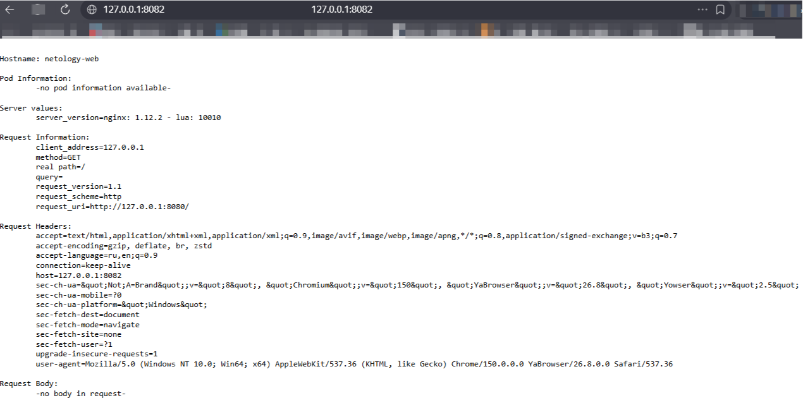
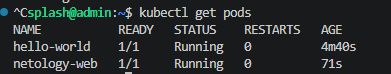

# Домашнее задание к занятию "`Базовые объекты K8S`" - `Гайченков Евгений`

## Задание 1. Создание Pod hello-world

Создан Pod `hello-world` с образом `gcr.io/kubernetes-e2e-test-images/echoserver:2.2`.

[Манифест Pod hello-world](manifests/hello-world.yaml)

Применение манифеста и проверка готовности:

```bash
kubectl apply -f manifests/hello-world.yaml
```

Подключение к Pod через перенаправление портов:

```bash
kubectl port-forward pod/hello-world 8081:8080
```

Получен ответ echoserver со сведениями о запросе и Pod.



## Задание 2. Создание Pod netology-web и Service netology-svc

Создан Pod `netology-web` с образом `gcr.io/kubernetes-e2e-test-images/echoserver:2.2` и Service `netology-svc` типа `ClusterIP`.

Service выбирает Pod по метке `app: netology-web`. Порт `80` сервиса направлен на порт `8080` контейнера.

[Манифест Pod netology-web и Service netology-svc](manifests/netology-web.yaml)

Применение манифеста и проверка ресурсов:

```bash
kubectl apply -f manifests/netology-web.yaml
kubectl get service netology-svc
kubectl get endpointslices -l kubernetes.io/service-name=netology-svc
```

Подключение через Service:

```bash
kubectl port-forward service/netology-svc 8082:80
```

Получен ответ echoserver от Pod `netology-web`.


## Состояние Pod

Проверка:

```bash
kubectl get pods
```

