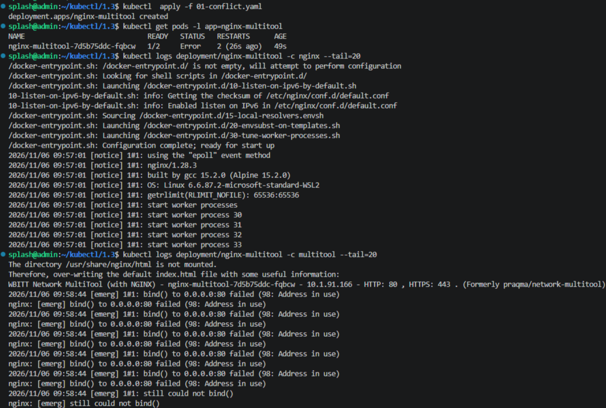
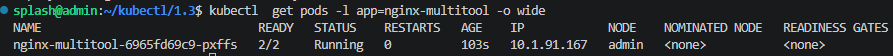
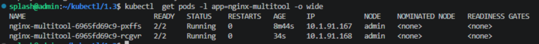
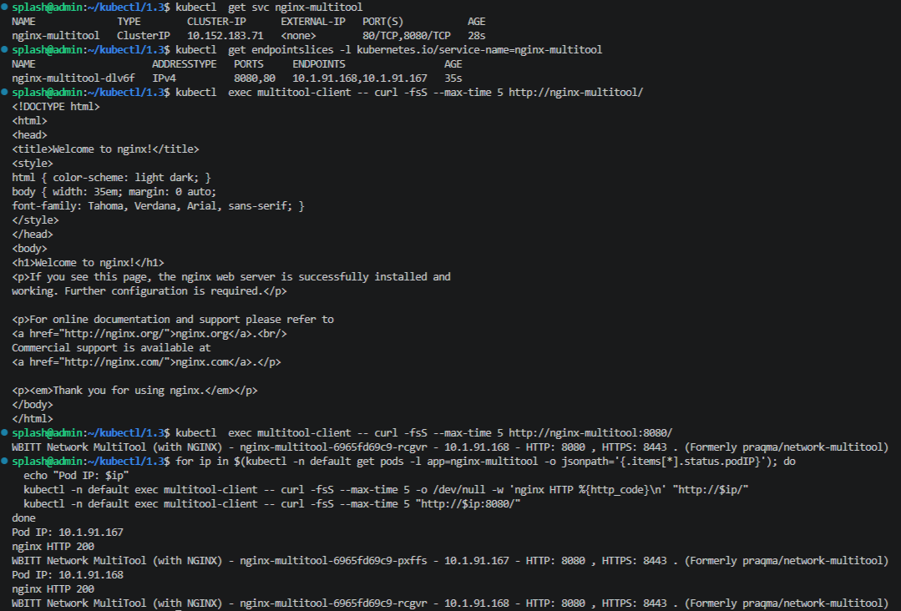
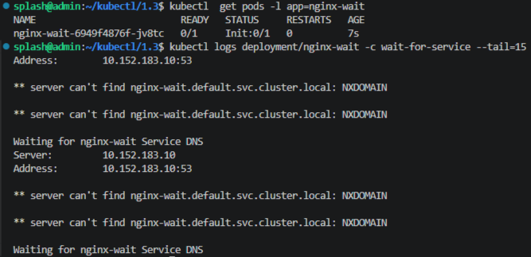
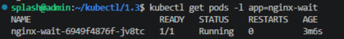

# Домашнее задание к занятию "`Запуск приложений в K8S`" - `Гайченков Евгений`

## Задание 1

[Манифест для воспроизведения ошибки](manifests/01-conflict.yaml)

### Исправление и масштабирование

[Исправленный Deployment](manifests/02-deployment.yaml)

### Доступ из другого Pod

[Service](manifests/03-service.yaml) · [Pod multitool-client](manifests/04-client.yaml)

## Задание 2

[Deployment с Init-контейнером](manifests/05-init-deployment.yaml) · [Service для nginx](manifests/06-init-service.yaml)

### После создания Service

