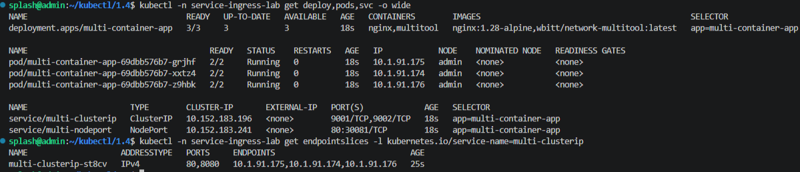
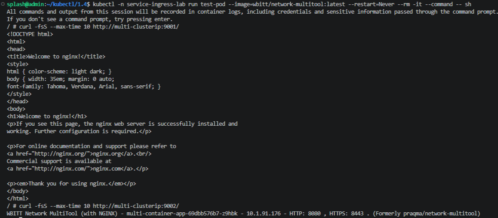
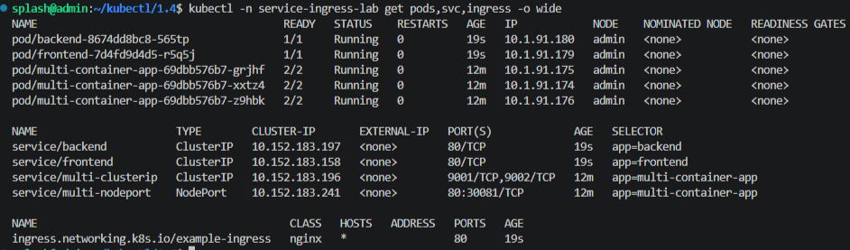
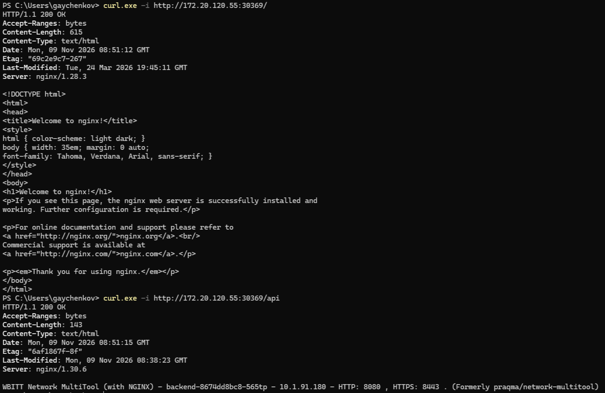

# Домашнее задание к занятию "`Сетевое взаимодействие в Kubernetes`" - `Гайченков Евгений`

## 1. ClusterIP и NodePort

- [deployment-multi-container.yaml](manifests/deployment-multi-container.yaml)
- [service-clusterip.yaml](manifests/service-clusterip.yaml)
- [service-nodeport.yaml](manifests/service-nodeport.yaml)

### ClusterIP: запросы из отдельного Pod

### NodePort: запрос из Windows

## 2. Маршрутизация через Ingress

- [deployment-frontend.yaml](manifests/deployment-frontend.yaml)
- [deployment-backend.yaml](manifests/deployment-backend.yaml)
- [service-frontend.yaml](manifests/service-frontend.yaml)
- [service-backend.yaml](manifests/service-backend.yaml)
- [ingress.yaml](manifests/ingress.yaml)

