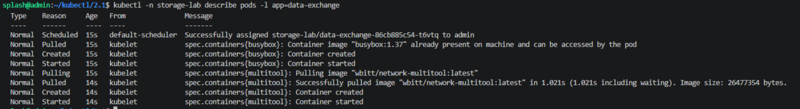
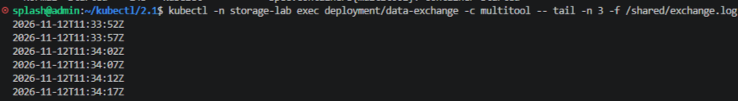
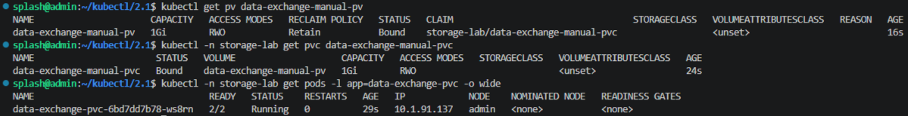
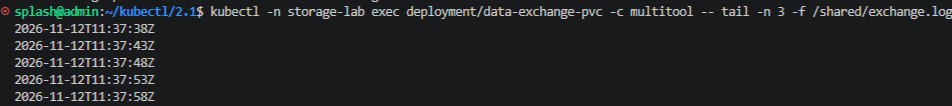
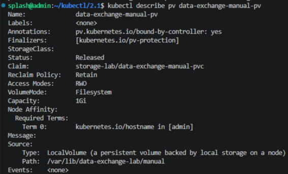
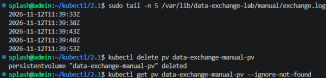
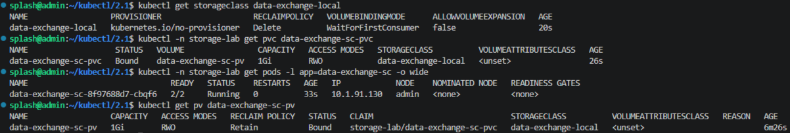
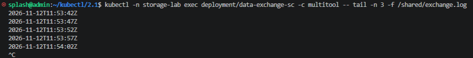

# Домашнее задание к занятию "`Хранение в K8s`" - `Гайченков Евгений`

## 1. Обмен данными через emptyDir

[Манифест containers-data-exchange.yaml](manifests/containers-data-exchange.yaml)

## 2. Локальный PV, созданный вручную

[Манифест pv-pvc.yaml](manifests/pv-pvc.yaml)

Удаление PV удаляет объект Kubernetes. Локальная директория и файл остаются на диске, так как том создан вручную и использует `Retain`.

## 3. PVC на основе StorageClass

[Манифест sc.yaml](manifests/sc.yaml)

Класс `data-exchange-local` использует `kubernetes.io/no-provisioner` и `WaitForFirstConsumer`. Поэтому манифест также содержит заранее подготовленный локальный PV с тем же классом. PVC не указывает имя PV: подходящий том подбирается при планировании Pod.

