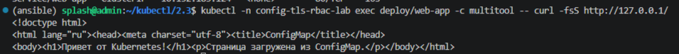
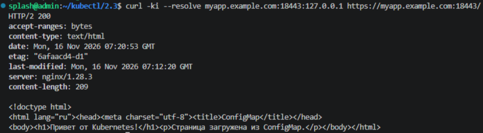
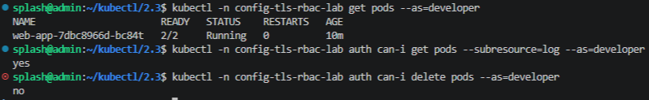

# Домашнее задание к занятию "`Настройка приложений и управление доступом в Kubernetes`" - `Гайченков Евгений`

## 1. ConfigMap

[deployment.yaml](manifests/deployment.yaml) · [configmap-web.yaml](manifests/configmap-web.yaml) · [service.yaml](manifests/service.yaml)



## 2. HTTPS

[secret-tls.yaml](manifests/secret-tls.yaml) · [ingress-tls.yaml](manifests/ingress-tls.yaml)



## 3. RBAC

[role-pod-reader.yaml](manifests/role-pod-reader.yaml) · [rolebinding-developer.yaml](manifests/rolebinding-developer.yaml)



### Клиентский сертификат и проверка входа

```bash
mkdir -p private
chmod 700 private
(umask 077; openssl genrsa -out private/developer.key 2048)
openssl req -new -key private/developer.key -out private/developer.csr -subj '/CN=developer'
printf 'extendedKeyUsage=clientAuth\n' > private/client-ext.cnf
ca=/var/snap/microk8s/current/certs
sudo openssl x509 -req -in private/developer.csr -CA "$ca/ca.crt" -CAkey "$ca/ca.key" \
  -set_serial "0x$(openssl rand -hex 16)" -out private/developer.crt -days 365 -extfile private/client-ext.cnf
sudo cat "$ca/ca.crt" > private/cluster-ca.crt
api=$(kubectl config view --minify -o jsonpath='{.clusters[0].cluster.server}')
cfg="$PWD/private/developer.kubeconfig"
kubectl --kubeconfig "$cfg" config set-cluster microk8s --server="$api" --certificate-authority=private/cluster-ca.crt --embed-certs=true
kubectl --kubeconfig "$cfg" config set-credentials developer --client-certificate="$PWD/private/developer.crt" --client-key="$PWD/private/developer.key"
kubectl --kubeconfig "$cfg" config set-context developer --cluster=microk8s --user=developer --namespace=config-tls-rbac-lab
kubectl --kubeconfig "$cfg" config use-context developer
pod=$(kubectl -n config-tls-rbac-lab get pod -l app=web-app -o jsonpath='{.items[0].metadata.name}')
```