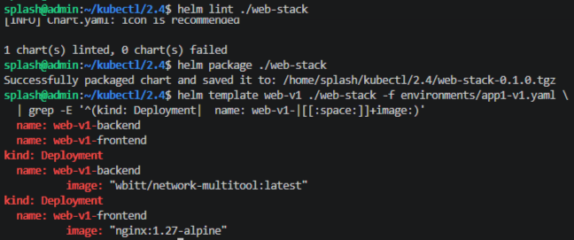
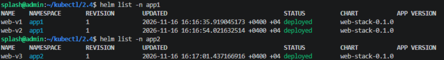
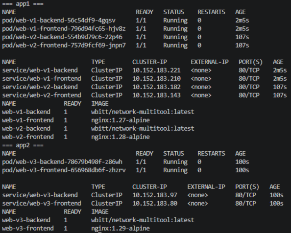
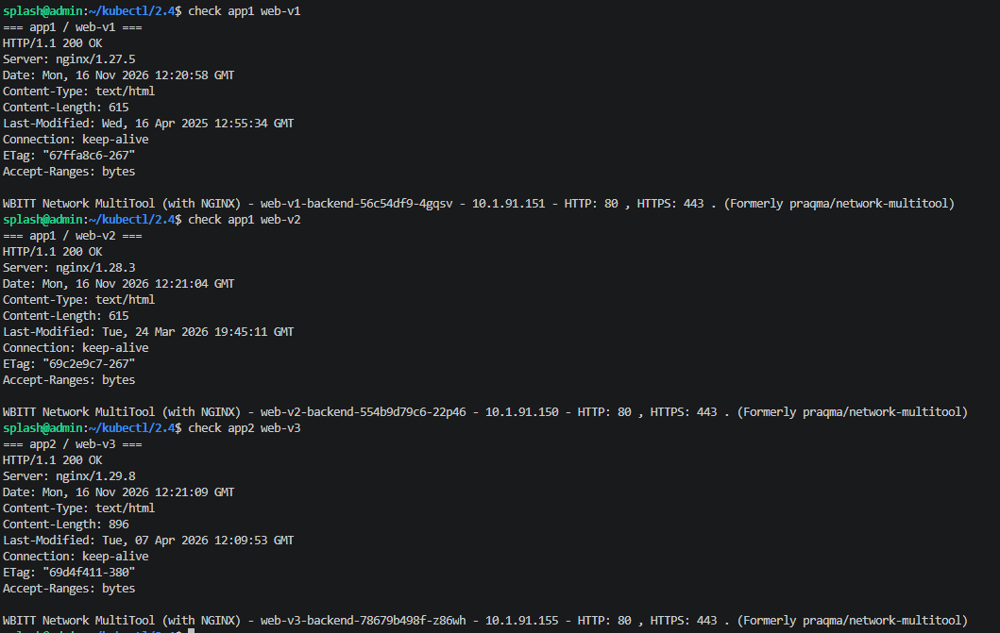

# Домашнее задание к занятию "`Helm`" - `Гайченков Евгений`

[Описание чарта](web-stack/Chart.yaml) · [Значения по умолчанию](web-stack/values.yaml) · [Deployment](web-stack/templates/deployments.yaml) · [Service](web-stack/templates/services.yaml)

| Namespace | Релиз | Образ frontend | Values |
| --- | --- | --- | --- |
| app1 | web-v1 | nginx:1.27-alpine | [app1-v1.yaml](environments/app1-v1.yaml) |
| app1 | web-v2 | nginx:1.28-alpine | [app1-v2.yaml](environments/app1-v2.yaml) |
| app2 | web-v3 | nginx:1.29-alpine | [app2-v3.yaml](environments/app2-v3.yaml) |

## Проверка и упаковка

## Установка трёх релизов

## Проверка HTTP

