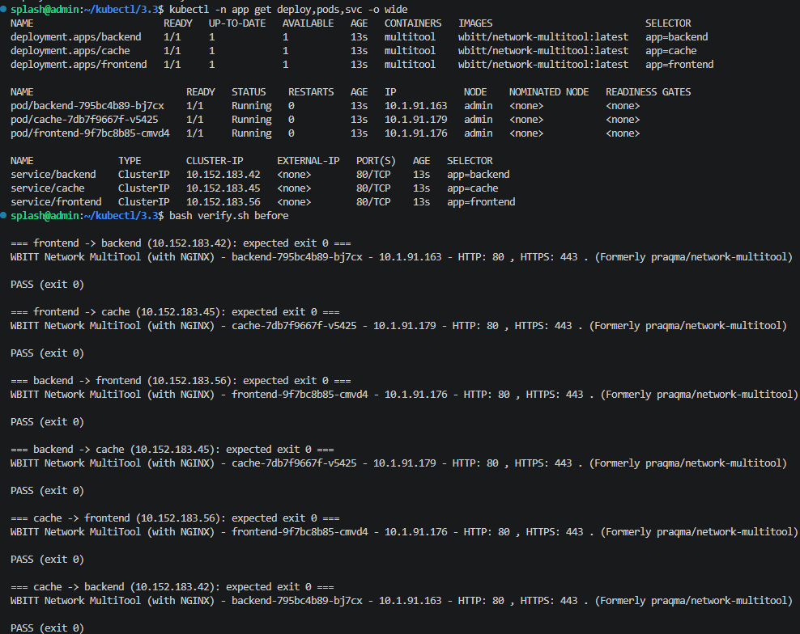
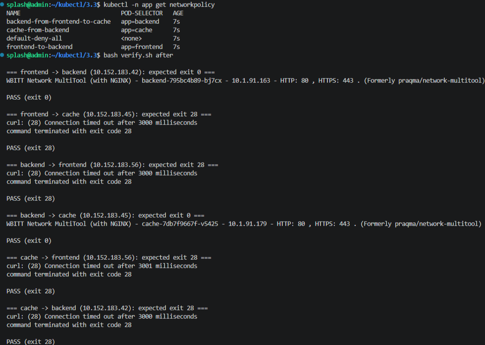

# Домашнее задание к занятию "`Как работает сеть в K8s`" - `Гайченков Евгений`

[Namespace](manifests/namespace.yaml) · [Deployment и Service](manifests/apps.yaml) · [NetworkPolicy](manifests/network-policies.yaml) · [Скрипт проверки](verify.sh)

