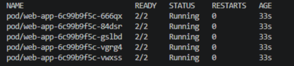
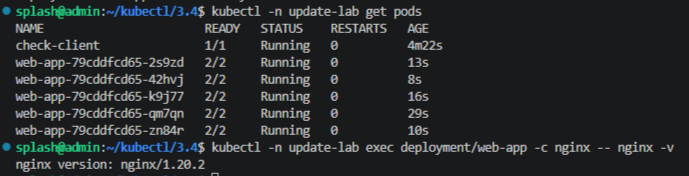
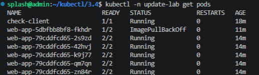
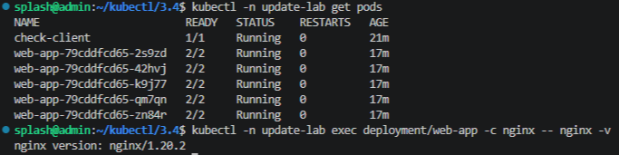

# Домашнее задание к занятию "`Обновление приложения Kubernetes`" - `Гайченков Евгений`

## Задание 1. Выбор стратегии

Выбираю **Recreate с согласованным окном недоступности**. Новая мажорная версия несовместима со старой, поэтому совместная работа реплик разных версий недопустима. RollingUpdate и Canary допускают такое сосуществование, а полноценный Blue/Green требует второго комплекта ресурсов. Запаса 20% для этого недостаточно.

При Recreate сначала останавливаются старые реплики, затем запускаются новые. Нужно остановить приём запросов и фоновых задач, дождаться завершения обработки, сделать резервную копию и выполнить необходимые миграции данных. Если миграции необратимы, откат одного образа не восстановит работоспособность: нужен отдельный план восстановления данных. Цена этой стратегии — перерыв в работе. Без дополнительных условий из задания нельзя одновременно гарантировать нулевой простой и отсутствие пересечения несовместимых версий.

## Задание 2. Практика RollingUpdate

[Deployment и Service](manifests/deployment.yaml)

### Запуск в MicroK8s на WSL

### Успешное обновление

### Несуществующий образ

### Откат

