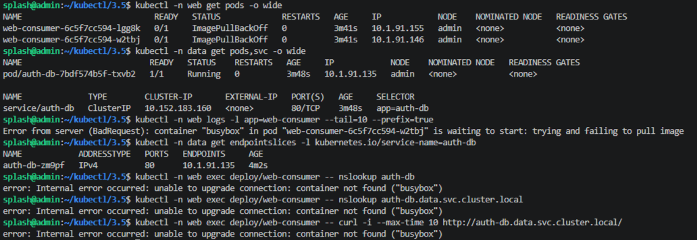
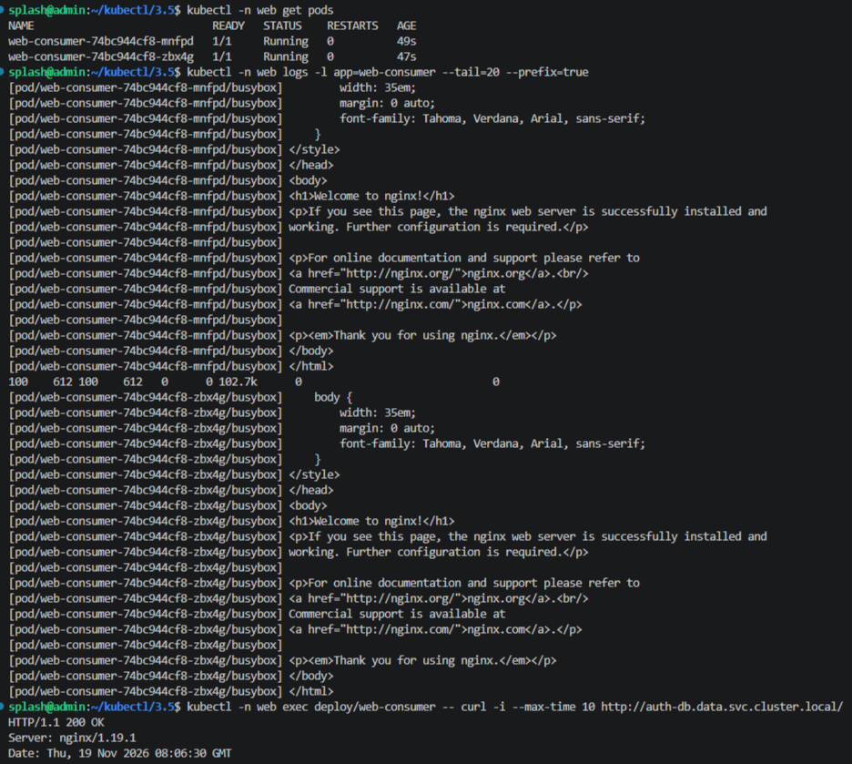

# Домашнее задание к занятию "`Troubleshooting`" - `Гайченков Евгений`

## Причина

[Исходный манифест Netology](https://raw.githubusercontent.com/netology-code/kuber-homeworks/main/3.5/files/task.yaml) размещает web-consumer в namespace web, а Service auth-db — в namespace data. В цикле клиента используется короткое имя auth-db. Такое имя ищется в namespace клиента, а не в data. Поэтому при исправном кластерном DNS клиент не находит сервис. У Service корректные selector и targetPort: ошибка в адресе обращения.

## Диагностика

## Исправление

radial/busyboxplus у меня не смог спулится, поэтому я заменил его на wbitt/network-multitool

[Стратегический патч Deployment](manifests/web-consumer-patch.yaml)

[Исправление](manifests/web-consumer-result.yaml)