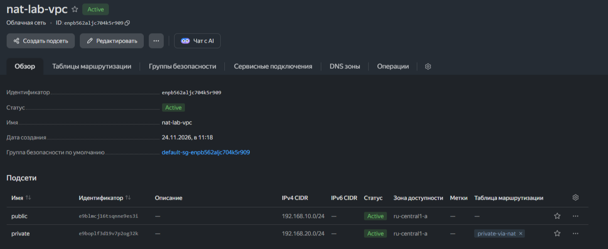
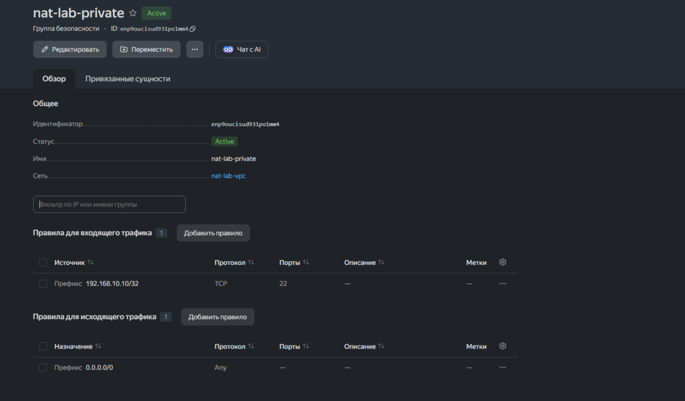
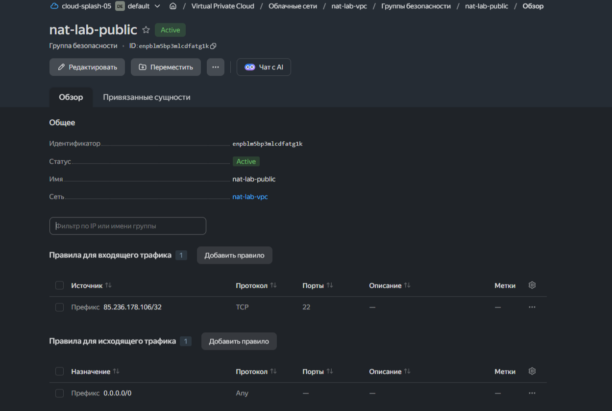
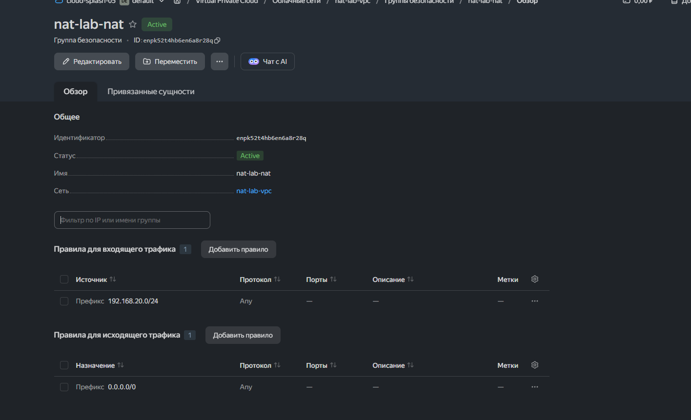
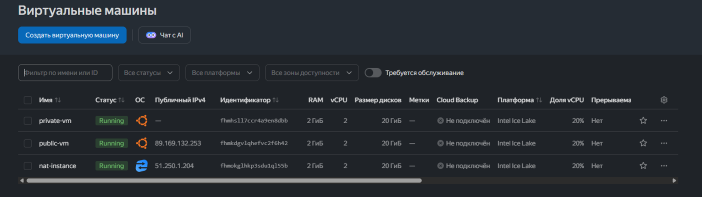
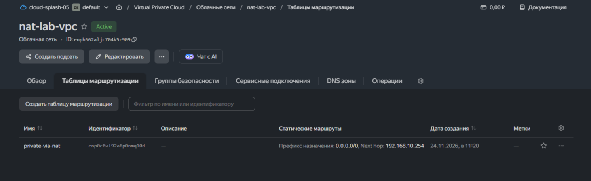
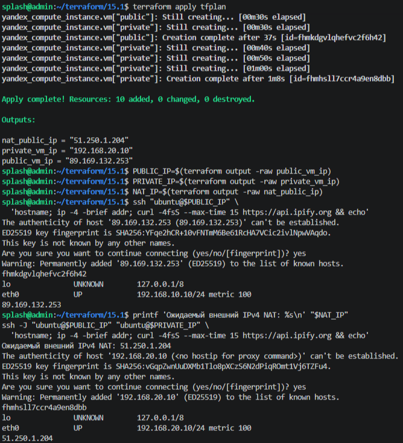

# Домашнее задание к занятию "`Организация сети`" - `Гайченков Евгений`

Зона доступности — `ru-central1-a`. В отдельной VPC `nat-lab-vpc` создаются две подсети. Конфигурация описана в [main.tf](main.tf)

| Подсеть | CIDR | ВМ | Внутренний IP | Публичный IPv4 |
| --- | --- | --- | --- | --- |
| `public` | `192.168.10.0/24` | `nat-instance` | `192.168.10.254` | Да |
| `public` | `192.168.10.0/24` | `public-vm` | `192.168.10.10` | Да |
| `private` | `192.168.20.0/24` | `private-vm` | `192.168.20.10` | — |

NAT-инстанс использует образ `fd80mrhj8fl2oe87o4e1`. К подсети `private` привязана таблица `private-via-nat` с маршрутом `0.0.0.0/0 → 192.168.10.254`. Доступ по SSH к `private-vm` идёт через `public-vm`. Исходящий интернет-трафик `private-vm` идёт через `nat-instance`.

