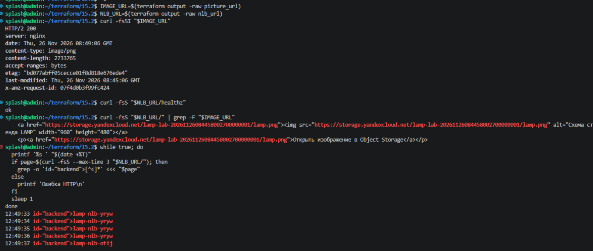
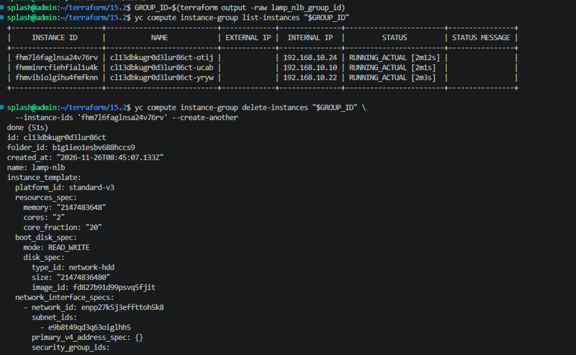
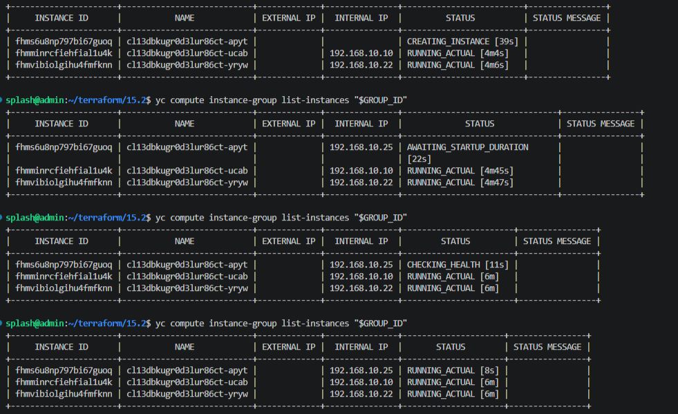
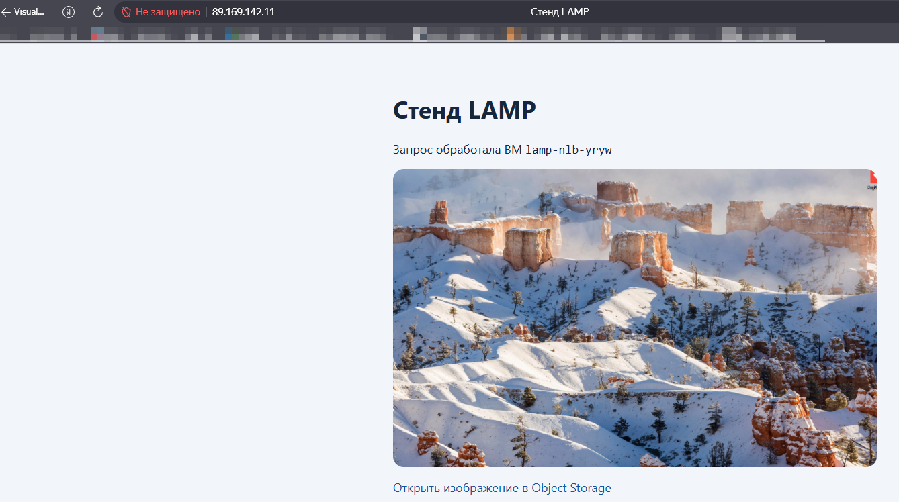

# Домашнее задание к занятию "`Организация сети`" - `Гайченков Евгений`

- [storage.tf](storage.tf) создаёт бакет с уникальным именем и загружает
  [изображение](assets/lamp.png). Анонимным клиентам доступно чтение объектов.
  Просмотр списка объектов и конфигурации бакета закрыт.
- [lamp.tf](lamp.tf) создаёт фиксированную группу из трёх LAMP-ВМ в `public`.
  Cloud-init публикует стартовую страницу со ссылкой на изображение и именем
  ВМ, ответившей на запрос. ВМ группы используют внутренние IP-адреса.
- [nlb.tf](nlb.tf) создаёт внешний Network Load Balancer на TCP/80 и подключает
  целевую группу. Instance Groups и балансировщик проверяют `GET /healthz`.
- [alb.tf](alb.tf) добавляет внешний HTTP-балансировщик, маршрутизацию и
  проверку `/healthz`. При `enable_alb = true` создаётся отдельная группа из
  трёх LAMP-ВМ, поскольку Yandex Cloud поддерживает только одну встроенную
  интеграцию с балансировщиком на группу.

